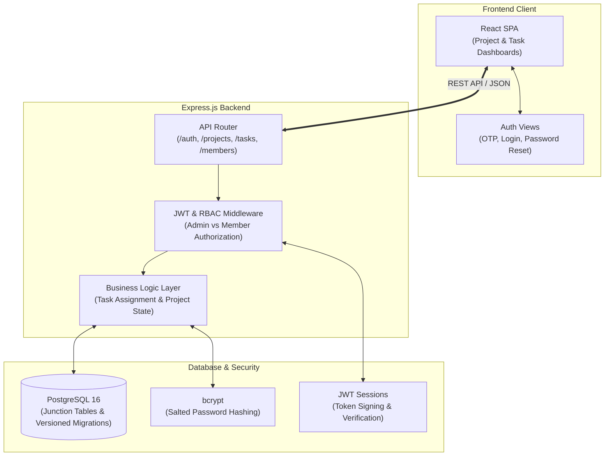

# TeamFlow: Team Task Manager

A collaborative, multi-tenant task and project management web application built with **React**, **Node.js**, **Express**, and **PostgreSQL**, featuring granular role-based access control (RBAC), OTP-verified user onboarding, and relational schema migrations.

---

## Architecture & System Overview

TeamFlow decouples client-side project visualization from a modular Express REST backend backed by a relational PostgreSQL database.

---

## Key Highlights & Features

### 1. Robust Authentication & Session Lifecycle
- **Password Security**: Passwords salted and hashed with `bcrypt`.
- **OTP Verification**: Secure one-time password flow for user signup and email validation.
- **Stateless JWT Sessions**: JSON Web Tokens for stateless, scalable session verification.
- **Custom Password Reset**: End-to-end self-service credential recovery built from scratch without external SaaS lock-in.

### 2. Express Middleware Role-Based Access Control (RBAC)
- Enforces strict **Admin vs. Member** permissions per project directly within Express middleware.
- Verifies project membership and access privileges before executing write, update, or destructive actions.

### 3. PostgreSQL Relational Data Modeling & Migrations
- **Multi-Assignee Task Relationships**: Tasks assigned to multiple project members modeled efficiently using a normalized `task_assignments` junction table.
- **Versioned Schema Migrations**: Four structured SQL migrations ensuring clean, predictable database evolutionary changes across development and production environments.

---

## Technical Specifications

| Component | Technology | Description |
| :--- | :--- | :--- |
| **Frontend** | React, HTML5, CSS3, Vite | Responsive project and task management dashboard |
| **Backend** | Node.js, Express.js | Modular RESTful API design with separation of concerns |
| **Database** | PostgreSQL 16 | Relational schema with junction tables and foreign key constraints |
| **Authentication** | bcrypt, JSON Web Tokens (JWT), OTP | Secure password hashing, tokenized auth, and recovery |
| **Source Code** | [github.com/yuvrajgovindrao/team-task-manager](https://github.com/yuvrajgovindrao/team-task-manager) | Open-source repository |
